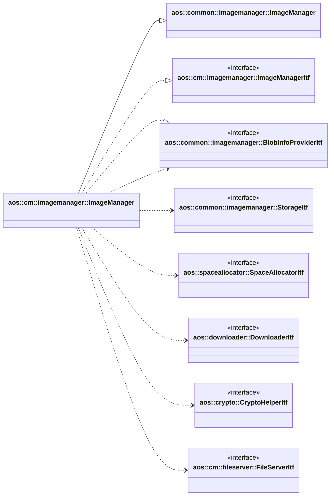

# Image manager

CM image manager downloads update items from the cloud, verifies them and keeps their blobs for the CM modules and the
SM image managers. It is derived from the
[common image manager](../../common/imagemanager/imagemanager.hpp), which stores the blobs, keeps the item statuses
and removes the outdated items. The CM part implements the download of the blobs from the cloud and manages the
temporary download files.

It implements the following interfaces:

* [aos::cm::imagemanager::ImageManagerItf](itf/imagemanager.hpp) - installs and removes update items;
* [aos::common::imagemanager::BlobInfoProviderItf](../../common/imagemanager/itf/blobinfoprovider.hpp) - provides
  download info of the stored blobs to the SM image managers;
* [aos::common::imagemanager::ItemStatusProviderItf](../../common/imagemanager/itf/itemstatusprovider.hpp) - provides
  update items statuses (inherited from the common image manager);
* [aos::common::imagemanager::ItemInfoProviderItf](../../common/imagemanager/itf/iteminfoprovider.hpp) - provides
  local blob paths (inherited from the common image manager);
* [aos::spaceallocator::ItemRemoverItf](../../common/spaceallocator/itf/spaceallocator.hpp) - removes outdated items:
  the remover of the blobs is provided by the common image manager, the remover of the temporary download files by
  `GetDownloadItemRemover`.

It requires the following interfaces:

* [aos::common::imagemanager::BlobInfoProviderItf](../../common/imagemanager/itf/blobinfoprovider.hpp) - provides
  download info of the blobs from the cloud;
* [aos::common::imagemanager::StorageItf](../../common/imagemanager/itf/storage.hpp) - stores items and their blobs;
* [aos::spaceallocator::SpaceAllocatorItf](../../common/spaceallocator/itf/spaceallocator.hpp) - allocates the space
  of the blobs and, with a separate instance, the space of the temporary download files;
* [aos::downloader::DownloaderItf](../../common/downloader/itf/downloader.hpp) - downloads blobs;
* [aos::crypto::CryptoHelperItf](../../common/crypto/itf/cryptohelper.hpp) - decrypts blobs and verifies their
  signatures;
* [aos::cm::fileserver::FileServerItf](../fileserver/itf/fileserver.hpp) - translates local blob paths to URLs;
* [aos::fs::FileInfoProviderItf](../../common/tools/fs.hpp) - gets file info (size, checksum);
* [aos::oci::OCISpecItf](../../common/ocispec/itf/ocispec.hpp) - parses OCI spec files;
* [aos::fs::FSPlatformItf](../../common/tools/fs.hpp) - flushes the file system.

## Overview

The blobs of the update items are stored by the common image manager as `<imagePath>/blobs/<algorithm>/<hash>`. The
root blob of a CM item is the OCI image index, as the CM manages the images of several architectures. The layers are
kept as packed blobs: the CM doesn't unpack them.

The blobs are downloaded to the temporary files `<downloadPath>/<algorithm>/<hash>` on the download partition, and
then decrypted or copied to the image storage. The temporary files are kept after the download, so an interrupted
download is resumed and a blob is not downloaded again if it is needed again, for example to repair the blob in the
image storage. The temporary files are removed by the download space allocator when the download space is needed.

The CM update manager calls `SetCerts` with the certificates of the desired status, `InstallItem` for each item of the
desired status and `RemoveItem` for each stored item that is not in the desired status. Up to `cMaxNumConcurrentItems`
items are installed or removed at the same time.

## Install item

`InstallItem` converts the update item info to the common install item info with the image index as the root blob and
calls `InstallItem` of the common image manager, which processes the blobs of the item and calls `DownloadBlob` for
each blob that is missing or invalid.

`DownloadBlob`:

* restores the temporary file of the blob from the outdated items of the download space allocator, see
  [Download space](#download-space);
* removes the temporary file if it is larger than the blob size and frees its space; a complete temporary file is
  reused without downloading;
* allocates the space of the rest of the temporary file in the download space allocator and downloads the blob with
  all its URLs. The download is canceled through the cancel context of the common image manager;
* on download failure or cancel, the allocated space is resized to the downloaded size and accepted, so the download is
  resumed by the next `DownloadBlob` of the blob;
* validates the size and, if provided, the SHA3-256 checksum of the temporary file;
* decrypts the temporary file to the blob path if the decrypt info is set, otherwise copies it;
* verifies the signature of the blob with the certificates set by `SetCerts` if the sign info is set;
* removes the temporary file and frees its space if the checksum validation, the decryption or the signature
  verification fails, as the downloaded content is broken.

The space of the blob in the image storage is allocated and the blob is validated by the common image manager.

## Download space

The temporary files of the blobs that are not being downloaded are registered as outdated items of the download space
allocator, identified by the blob digest with an empty version, so they are removed when the download space is needed.
The item remover of the download space allocator is returned by `GetDownloadItemRemover`: it removes the temporary
file of the digest and returns its size.

When `DownloadBlob` starts, it restores the temporary file of the blob from the outdated items, so the space
allocation doesn't remove it. If no other blob is being downloaded, it also registers the temporary files found in the
download directory with their modification time as the timestamp, which registers the files left by a previous run,
and removes the files that don't match a valid digest.

When `DownloadBlob` ends and the temporary file is kept, the modification time of the file is updated and the file is
added to the outdated items with it, so the least recently used temporary files are removed first.

## Cancel

`Cancel` cancels all items being installed and waits until all `InstallItem` and `RemoveItem` calls in progress
return. It is implemented by the common image manager: the downloads in progress are canceled through the cancel
context passed to the downloader.

## Blob info for SM

`GetBlobInfo` provides the download info of a stored blob to the SM image managers: the digest, the size of the blob
and its URL translated from the local path by the file server. The checksum is not provided, as the SM image manager
validates the downloaded blob against its digest. The blob is not locked while the SM downloads it. `eNotFound` is
returned if the blob is not referenced by any stored item.
