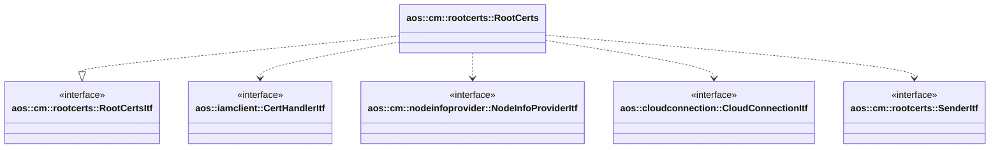

# Root certificates

Root certificates module synchronizes unit root certificates between Aos cloud and unit nodes.

It implements the following interfaces:

* [aos::cm::rootcerts::RootCertsItf](itf/rootcerts.hpp) - processes desired unit root certificates received from Aos
  cloud.

It requires the following interfaces:

* [aos::iamclient::CertHandlerItf](../../common/iamclient/itf/certhandler.hpp) - updates and gets node root
  certificates;
* [aos::cm::nodeinfoprovider::NodeInfoProviderItf](../nodeinfoprovider/itf/nodeinfoprovider.hpp) - provides unit
  node IDs and notifies about node info changes;
* [aos::cloudconnection::CloudConnectionItf](../../common/cloudconnection/itf/cloudconnection.hpp) - notifies about
  cloud connection state;
* [aos::cm::rootcerts::SenderItf](itf/sender.hpp) - sends unit root certificates to Aos cloud.

## Root certificates reporting

When the cloud connection is established, the module sends a full snapshot (`isPartial` is `false`) of SHA-256
fingerprints of root certificates installed on all unit nodes. Nodes for which root certificates can't be obtained are
skipped.

When node info is changed while the cloud is connected, the module sends a partial report (`isPartial` is `true`)
containing root certificate fingerprints of the changed node only.

## aos::cm::rootcerts::RootCerts

### Init

Initializes the root certificates object instance.

### Start

Starts the root certificates object instance: subscribes to cloud connection and node info changes.

### Stop

Stops the root certificates object instance: unsubscribes from cloud connection and node info changes.

### ProcessDesiredRootCertificates

Applies desired root certificates received from the cloud to each listed node. Failure to update one node doesn't
prevent updating others.
