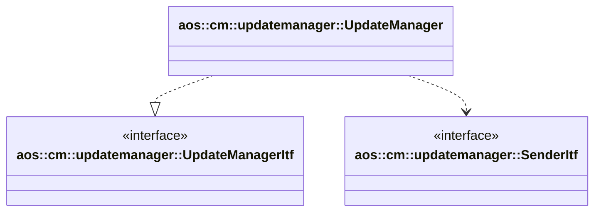

# Update manager

Update manager processes desired status from Aos cloud, downloads update images, and schedules update according to
update policy.

It implements the following interfaces:

* [aos::cm::updatemanager::UpdateManagerItf](itf/updatemanager.hpp) - implements main update manager functionality.

It requires the following interfaces:

* [aos::cm::updatemanager::SenderItf](itf/sender.hpp) - sends unit status message to Aos cloud.

## Items recovery

After waiting for the instances to become active, the instances are checked per update item, using the item ID and
version:

* if at least one instance has the `eIntegrity` error, the item is set to `eFailed` with this error, even if the other
  instances are not failed;
* otherwise, if all the instances are failed, the item is set to `eFailed` with the error of the first one;
* otherwise, the item state is not changed.

If there are items with the `eIntegrity` error, the update goes to the `eRecovering` state instead of `eFinalizing`:

* the update items in `eFailed` state with the `eIntegrity` error are installed again. The image manager validates the
  blobs of a stored item and downloads the missing or corrupted ones. The items failed with other errors are not;
* the update goes back to the `eLaunching` state, which runs all the instances again, and to `eWaitingActive`.

The recovery is performed once per update. If the instances fail again, their items are set to `eFailed` again, the
update is finalized and their states are reported in the unit status. The recovery can be canceled the same way as the
install, and it is resumed after a restart based on the stored items statuses.

Outside an update, the recovery is started by the instances statuses reported by the nodes or set by the CM launcher,
for example after the SM or CM restart, and also by a desired status that requires no update. The last desired status is
kept for it: a desired status that requires no update is stored and becomes the current one, and after a restart the
stored one is used until a new one arrives. If an item of this desired status is in `eInstalled` state and has an
instance failed with the `eIntegrity` error, the item is set to `eFailed` with this error and the update starts in the
`eRecovering` state, which installs the item again and goes on as above. The instances statuses are only checked in the
update thread when no update is running: on change and at least once per minute while idle. If the recovery fails, the
item stays `eFailed` and neither the following instances statuses nor the same desired status recover it again.
