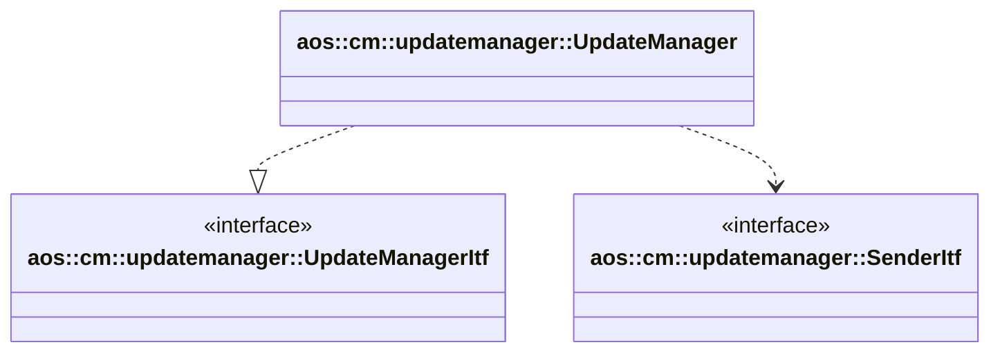

# Update manager

Update manager processes desired status from Aos cloud, downloads update images, and schedules update according to
update policy.

It implements the following interfaces:

* [aos::cm::updatemanager::UpdateManagerItf](itf/updatemanager.hpp) - implements main update manager functionality.

It requires the following interfaces:

* [aos::cm::updatemanager::SenderItf](itf/sender.hpp) - sends unit status message to Aos cloud.

## Update item failure

The update item status is provided by the image manager and covers download and installation only. The unit status
handler reports the installed item as `failed` when all its instances of this version are failed, with the error of one
of them. Instances are tracked by the handler: the delta unit status contains changed instances only. The failed item
is reported as `installed` again when any of its instances is not failed. A failure reported by the image manager is
not overridden.

Repeating the same desired status doesn't trigger an update for the failed component instance: it stays failed until
the desired status changes.
