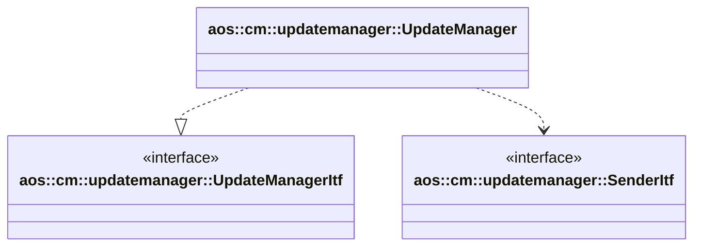

# Update manager

Update manager processes desired status from Aos cloud, downloads update images, and schedules update according to
update policy.

It implements the following interfaces:

* [aos::cm::updatemanager::UpdateManagerItf](itf/updatemanager.hpp) - implements main update manager functionality.

It requires the following interfaces:

* [aos::cm::updatemanager::SenderItf](itf/sender.hpp) - sends unit status message to Aos cloud.

## Items recovery

After waiting for the instances to become active, the instances are checked per update item, using the item ID and
version:

* if at least one instance has the `eIntegrity` error, the item state is not changed, even if the other instances are
  failed. The item is recovered by the changed instances statuses;
* otherwise, if all the instances are failed, the item is set to `eFailed` with the error of the first one;
* otherwise, the item state is not changed.

The items are never set to `eFailed` with the `eIntegrity` error: the instances statuses report it.

The recovery is started only by changed instances statuses that contain an instance failed with the `eIntegrity` error,
reported by the nodes or set by the CM launcher, for example during an update or after the SM or CM restart. The
recovery starts in the update thread when no update is running, so the changes made during an update start it after the
update. The items of the current desired status are recovered. A desired status that requires no update becomes the
current one and is stored if it differs from the current one (the protocol part is not compared). After a restart, the
stored desired status is used, so the items are recovered offline as well.

The update starts in the `eRecovering` state:

* the items to recover are found by the current instances statuses: the `eInstalled` items with an instance failed with
  the `eIntegrity` error. They are installed again: the image manager validates the blobs of a stored item and downloads
  the missing or corrupted ones;
* the update goes to the `eLaunching` state, which runs all the instances again, to `eWaitingActive` and `eFinalizing`.

The instances statuses changed by the recovery itself don't start the recovery again: if the instances fail again with
the `eIntegrity` error, the items stay installed and the failed instances are reported in the unit status. The recovery
is tried again by the next instances statuses change, for example after the SM restart. The recovery can be canceled
the same way as the install, and it is resumed after a restart in the `eRecovering` state.
