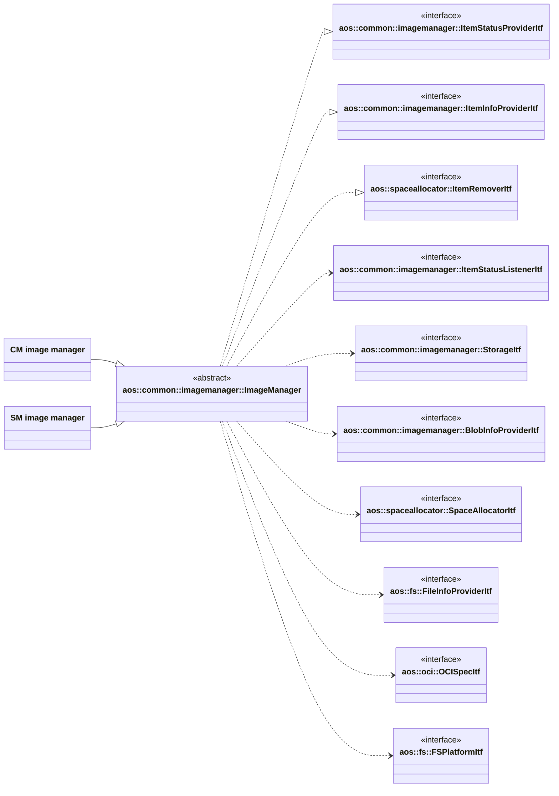

# Image manager

Common image manager implements the part of the image manager shared by CM and SM: installing and removing a single
version of a deployable item, tracking the blobs used by each item version and cleaning up the unused ones.

It is the base class of the CM and SM image managers. They call its protected `Init`, `InstallItem`, `RemoveItem` and
`Cancel` methods from their own API and specialize the blob download and the layer handling.

It implements the following interfaces:

* [aos::common::imagemanager::ItemStatusProviderItf](itf/itemstatusprovider.hpp) - provides deployable items statuses;
* [aos::common::imagemanager::ItemInfoProviderItf](itf/iteminfoprovider.hpp) - provides local blob and layer paths;
* [aos::spaceallocator::ItemRemoverItf](../spaceallocator/itf/spaceallocator.hpp) - removes outdated items, it is
  returned by `GetItemRemover` and should be passed to the space allocator.

It requires the following interfaces:

* [aos::common::imagemanager::StorageItf](itf/storage.hpp) - stores deployable items and their blob references;
* [aos::common::imagemanager::BlobInfoProviderItf](itf/blobinfoprovider.hpp) - gets the info to download a blob;
* [aos::spaceallocator::SpaceAllocatorItf](../spaceallocator/itf/spaceallocator.hpp) - allocates the space for blobs
  and keeps the outdated items;
* [aos::fs::FileInfoProviderItf](../tools/fs.hpp) - gets blob file size and checksum;
* [aos::oci::OCISpecItf](../ocispec/itf/ocispec.hpp) - parses image index, manifest and config;
* [aos::fs::FSPlatformItf](../tools/fs.hpp) - flushes the file system containing the blobs.

It notifies the following interface:

* [aos::common::imagemanager::ItemStatusListenerItf](itf/itemstatusprovider.hpp) - receives item status changes and
  item removals from the cache.



## Overview

A deployable item version is identified by its item ID and version. The root digest of a stored version never changes:
installing the same version with another root digest fails. Handling of a set of items is up to the caller.

Blobs are stored by digest and can be shared between items and versions:

```console
<mImagePath>/blobs/sha256/3588d02542238316759cbf24502f4344ffcc8a60c803870022f335d1390c13b4
<mImagePath>/blobs/sha512/...
```

The storage keeps a reference from each item version to each blob it uses. A blob is used if at least one stored item
references it, whatever the state of the item. The reference is added before the blob is validated or downloaded, so
the item being installed protects its blobs from being removed.

A removed item stays in the storage with its blobs in the `eRemoved` state, and is added as outdated to the space
allocator. It is completely removed from the cache when its space or storage record is needed, or when its cache TTL
expires.

## Item states

| State          | Reported when                                                                                 |
| -------------- | --------------------------------------------------------------------------------------------- |
| `eInstalling`  | the install is started and no blob is being downloaded yet                                    |
| `eDownloading` | the install has started downloading a blob                                                    |
| `eInstalled`   | the item is installed                                                                         |
| `eRemoving`    | the removal is in progress                                                                    |
| `eRemoved`     | the item is removed and kept in the cache                                                     |
| `eFailed`      | the last install failed, `mError` contains the error                                          |

`ePending` is not used by the image manager.

## Configuration

* `mImagePath` - path where the blobs are stored. `Init` fails with `eInvalidArgument` if it is too long to hold the
  longest blob path;
* `mPartLimit` - limit of the space used by the blobs, in percent of the partition. It isn't used by the image manager
  itself: the caller creates the space allocator with this limit;
* `mItemCacheTTL` - how long a removed item is kept in the cache;
* `mRemoveOutdatedPeriod` - how often the expired items and the orphan blobs are removed.

## Initialization

`Init` stores the configuration and the interfaces, and creates the blobs folder. It is called by the derived classes
from their own `Init`.

### Start

During start:

* items left in `eInstalling` or `eDownloading` state are set to `eFailed` with the `eCanceled` error: their install was
  interrupted, so they are handled as canceled items. Their blobs are kept and aren't downloaded again if the item is
  installed again;
* items in `eRemoved` state are added as outdated to the space allocator. An error of adding an item is only logged;
* the cleanup thread and its timer are started, see [Cleanup](#cleanup). `Start` doesn't wait for the cleanup.

No item status is notified on start: the changed items are reported by `GetItemsStatuses`. `Start` fails if the storage
can't be read or updated.

### Stop

`Stop` calls [Cancel](#cancel), then stops the timer and the cleanup thread, and waits until the cleanup in progress is
finished.

## Installing item

### InstallItem

Installs a single version of a deployable item. Up to `cMaxNumConcurrentItems` items are processed at the same time.
The call waits while the same item version is being installed or removed.

It performs the following steps:

* adds the item to the storage in `eInstalling` state, or sets the stored item to this state. An item in `eRemoved`
  state is restored from the outdated items of the space allocator. If the storage is full, the outdated items are
  removed. If there is nothing to remove, the call fails with `eNoMemory`;
* processes the blobs starting from `mRootDigest`, see [Processing blob](#processing-blob). If `mIsRootIndex` is set,
  the root blob is an image index and each of its manifests is processed. Otherwise, the root blob is an image manifest,
  which is used by SM that manages a dedicated architecture;
* for each manifest, processes the manifest blob, the item config, the image config and then the layers, see
  [Processing layer](#processing-layer). An empty config (`oci::cMediaTypeEmptyBlob`) is not parsed and is handled as no
  image config;
* flushes the file system containing `mImagePath`;
* sets the item state to `eInstalled`.

Errors detected before the install is started, such as a different root digest or a full storage, are only returned:
the storage isn't changed and no status is notified.

Any later failure sets the item to `eFailed` with the error, including the cancel. The item stays in the storage with
its processed blobs until it is installed again or removed. If the `eFailed` state can't be stored, the item stays in
`eInstalling` state in the storage and is reported as `eFailed` until the next start.

Installing a stored version repairs it: its blobs are validated and the missing or corrupted ones are downloaded again.

### Processing blob

Each blob is locked in the list of the blobs being processed, as it can be shared with another item being installed,
and is added to the storage as a blob of the item. Then:

* the blob is validated, see [Blob validation](#blob-validation). A valid blob is not downloaded;
* if the validation fails with `eNotFound`, `eInvalidChecksum` or `eIntegrity`, the blob is repaired. Any other error
  doesn't mean that the blob is invalid, so it is kept and the install fails;
* the existing blob file is removed and its space is freed in the space allocator;
* the blob info is requested from `BlobInfoProviderItf`, see [Getting blob info](#getting-blob-info);
* the space is allocated, `eDownloading` is notified and `DownloadBlob` is called;
* the space is resized to the size of the downloaded file. On success, it is accepted. On failure, the file is removed
  and the space is released. If the file can't be removed, the space is accepted, as the file still uses it;
* the blob is validated again. If it fails, the install fails and the invalid blob is repaired on the next install.

### Blob validation

The digest is split to the algorithm and the hash, and the file is compared with them. The validation fails with:

* `eInvalidArgument` if the digest is malformed;
* `eNotSupported` if the algorithm is neither `sha256` nor `sha512`;
* `eNotFound` if the blob file doesn't exist;
* `eInvalidChecksum` if the checksum doesn't match the hash, or the size is known from the descriptor and doesn't match
  the file size;
* any other error of `FileInfoProviderItf` as is, `eIntegrity` if the file can't be read because of the integrity
  checked storage.

### Getting blob info

`eNotFound` of `GetBlobInfo` fails the install, as the provider doesn't have the blob. So the provider must return it
only if the blob is really missing, not for a temporary failure. On any other error, the request is retried every
`cRetryTimeout` until it succeeds or is canceled, as the provider may be unavailable for a while.

### Processing layer

The layers are handled through the virtual methods, see [Derived image managers](#derived-image-managers):

* `ValidateLayer` is called first. On success, the layer is done and its blob isn't validated, as the derived class may
  remove the blob after unpacking;
* `eNotSupported` means that the layer is kept as a packed blob only, so only the layer blob is processed;
* any other error means that the unpacked layer is missing or invalid: `RemoveLayer` is called and the returned size is
  freed in the space allocator, the layer blob is processed and `UnpackLayer` is called.

### Cancel

Cancels all items being installed and waits until all `InstallItem` and `RemoveItem` calls in progress or waiting for
their item lock return. The removal itself is not canceled.

The image manager keeps one cancel context. It is passed to each `DownloadBlob`, checked before each blob and after
waiting for a blob being processed by another item, and interrupts the blob info retries. Canceled items fail as
described in [InstallItem](#installitem), usually with `eCanceled`.

The context is reset when the calls return, so items started after `Cancel` returns are not affected. `Cancel` calls are
serialized, as a call must not reset the context while another one still waits.

## Removing item

### RemoveItem

Removes a single version of a deployable item, waiting while the same item version is being installed. It fails with
`eNotFound` if the version is not stored, and does nothing if the item is already in `eRemoved` state.

It performs the following steps:

* notifies `eRemoving`;
* sets the item state to `eRemoved` with the current timestamp and notifies it. If the state can't be stored, the
  previous state is notified with the error and the call fails;
* unlocks the item and adds it as outdated to the space allocator. If adding fails, the call fails, but the item stays
  in `eRemoved` state and is added again on the next start.

The blobs and the blob references are kept, so they aren't downloaded again if the item is installed again.

### Removing outdated items

The space allocator removes the oldest outdated item with `aos::spaceallocator::ItemRemoverItf::RemoveItem`: when it
needs the space, when its list of outdated items is full, or when `InstallItem` needs a storage record.

An item is skipped if it is locked, was already removed from the storage or isn't in the `eRemoved` state anymore.
Otherwise, it is removed from the cache:

* the item and its blob references are removed from the storage;
* each blob which is not used by other items and is not being processed is removed, with `RemoveLayer` called for the
  layers. A blob failed to be removed is logged and removed later as orphan;
* `OnItemRemovedFromCache` is notified and the freed size is returned to the space allocator.

## Cleanup

The cleanup runs in a separate thread, right after `Start` and then every `mRemoveOutdatedPeriod`. It can run at the
same time as `InstallItem` and `RemoveItem`, so it skips the items and blobs being processed. Its errors are logged, and
the failed items and blobs are processed again in the next period.

It performs the following steps:

* removes the expired items, i.e. the items in `eRemoved` state for at least `mItemCacheTTL`. They are removed from the
  outdated items of the space allocator and from the cache as described in
  [Removing outdated items](#removing-outdated-items). An item which stays is added as outdated again;
* removes the orphan blobs, i.e. the files in the blobs folder not referenced by any stored item. The files which don't
  match a valid digest are removed as well;
* calls `RemoveOrphanLayers`, so the derived class removes its unused unpacked layers;
* frees the removed size in the space allocator.

## Locking

The space allocator calls the item remover synchronously with its own lock held, and the item remover takes the image
manager mutex. To avoid a deadlock:

* the space allocator is never called with `mMutex` held;
* the item remover never calls the space allocator and never waits for an item or a blob: the locked ones are skipped;
* `mStorageMutex` serializes the check of the stored items count with adding an item. It can be held while the space
  allocator is called, as the item remover doesn't take it.

The locks are taken in the following order: `mStorageMutex`, the space allocator lock, `mMutex`.

`mCancelMutex` serializes `Cancel` calls and is taken before `mMutex`. `mListenersMutex` is held while the listeners are
notified, and `mMutex` is not.

## Derived image managers

The following private virtual methods specialize the install. They are called only by the common image manager:

* `DownloadBlob` - downloads the blob to the given path. It is pure virtual. It checks the cancel context before and
  during the download, and returns `eCanceled` if it is canceled. It doesn't allocate the space and isn't required to
  validate the blob;
* `ValidateLayer` - validates the unpacked layer. It only reads the layer;
* `UnpackLayer` - unpacks the validated layer blob. On failure, it leaves no partially unpacked content;
* `RemoveLayer` - removes the unpacked layer and returns its size. It must not call the space allocator or wait for
  blobs and layers being processed, as it can be called by the item remover;
* `RemoveOrphanLayers` - removes the unpacked layers not used by any layer blob and returns their size, which is freed
  by the common image manager.

The layer methods return `eNotSupported` by default, which is treated as nothing to do. A derived class which overrides
`UnpackLayer` must override `ValidateLayer` and `RemoveLayer` as well.

The derived classes can also use `GetSpaceAllocator` and the static `ParseDigest`, and override `GetLayerPath`.

## aos::common::imagemanager::ItemStatusProviderItf

### GetItemsStatuses

Appends one status per item version in the storage to the output array, which is not cleared. An item being processed
is reported with its last notified state, otherwise the stored state is reported. An item left in `eInstalling` state
without an install in progress is reported as `eFailed`.

### SubscribeListener

Subscribes to item status changes. It returns `eAlreadyExist` if the listener is already subscribed.

### UnsubscribeListener

Unsubscribes from item status changes. It returns `eNotFound` if the listener is not subscribed.

## aos::common::imagemanager::ItemStatusListenerItf

Listeners are notified with the listeners mutex held, so a listener must not subscribe or unsubscribe from the callback.

### OnItemStatusChanged

Called for each listener when an item status is changed. The final status of the install is notified while the item is
still locked, so the listener must not call `InstallItem` or `RemoveItem` synchronously.

### OnItemRemovedFromCache

Called for each listener when an item is completely removed from the cache. It is not called when the item is set to
`eRemoved` state. It can be called from the item remover with the space allocator lock held, so the listener must not
call the image manager or the space allocator.

## aos::common::imagemanager::ItemInfoProviderItf

### GetBlobPath

Returns the blob path `<mImagePath>/blobs/<algorithm>/<hash>` by digest. It fails with `eInvalidArgument` if the digest
is malformed. It doesn't check that the blob exists: a blob of an item in `eRemoved` state can be removed at any time,
so a consumer must handle a missing blob as an error.

### GetLayerPath

Returns the unpacked layer path by diff ID. It returns `eNotSupported`, as the common image manager doesn't keep the
unpacked layers. The derived class which keeps them overrides it.
