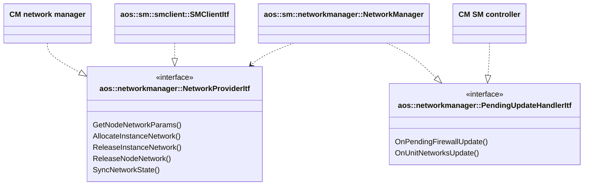
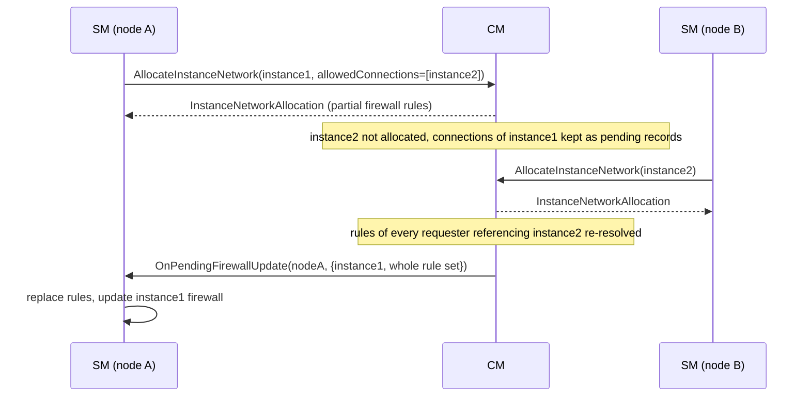
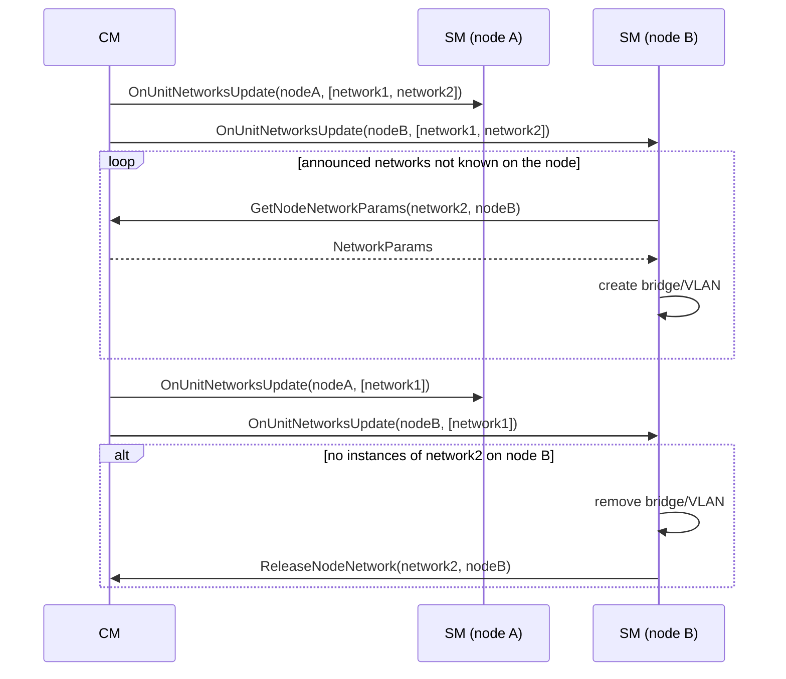

# Network manager

This document describes the network manager interfaces shared between CM (Communication Manager) and SM (Service
Manager). They define the contract for allocating and releasing network resources, synchronizing network state on
(re)connect, delivering deferred firewall rule updates and announcing the networks of the unit.

The overall networking architecture is described in the public documentation:

- [Networking overview][arch-overview];
- [Per-instance network lifecycle][arch-lifecycle].

The SM side implementation of this contract is described in [SM network manager][sm-networkmanager].

[arch-overview]: https://github.com/aosedge/public-docs/blob/main/docs/aos-core/14-network/index.md
[arch-lifecycle]: https://github.com/aosedge/public-docs/blob/main/docs/aos-core/14-network/per-instance-networking.md
[sm-networkmanager]: ../../sm/networkmanager/networkmanager.md

## Overview

CM is the allocator: it hands out subnets, IP addresses and per-instance firewall policy and keeps them consistent
across the unit. SM is the runtime owner: it asks CM what an instance network should look like and builds it on the
node.

CM also keeps the set of networks that exist in the unit and announces it to every node. SM keeps every network of
this set present on its node, whether or not the node runs instances of it, so instances of different networks on
different nodes can reach each other and an instance can move to another node without waiting for its network.

The interfaces are placed in `common` because both sides depend on them:

- [aos::networkmanager::NetworkProviderItf](itf/networkprovider.hpp) - SM -> CM requests. On the SM side it is
  implemented by SM client, which forwards the calls to CM over the network service. On the CM side it is implemented
  by CM network manager;
- [aos::networkmanager::PendingUpdateHandlerItf](itf/pendingupdatehandler.hpp) - CM -> SM notifications. On the CM
  side it is implemented by SM controller, which pushes the update to the node over the stream. On the SM side it is
  implemented by SM network manager, which applies the update.

## aos::networkmanager::NetworkProviderItf

Network provider interface used by SM to request network resources from CM.

### GetNodeNetworkParams

Returns node network parameters (`NetworkParams`: subnet, bridge IP, VLAN ID) for the given network and node. SM calls
it once per network when the network is not known on the node yet: when CM announces it in the unit networks (see
[Unit networks](#unit-networks)) or when the first instance of that network is created on the node.

### AllocateInstanceNetwork

Allocates network resources for an instance on CM. SM passes the instance identifier, network ID, node ID and the
service network data (`UpdateItemNetworkParams`: hosts, exposed ports, allowed connections). CM returns the allocated
parameters (`InstanceNetworkAllocation`: IP, subnet, DNS servers, firewall rules).

If some of the allowed connections point to targets that are not allocated yet, CM returns partial firewall rules
and delivers the complete rule set later, once the targets appear (see
[Deferred firewall rules](#deferred-firewall-rules)).

### ReleaseInstanceNetwork

Releases instance network resources on CM. SM calls it when the instance network is released.

### ReleaseNodeNetwork

Releases node network resources on CM. SM calls it when the network is not in the unit networks and the node has no
instances of it: when the network leaves the unit networks or when its last instance on the node is released.

### SyncNetworkState

Sends the current network state of the node to CM. SM calls it every time it connects or reconnects to CM and passes
the running instances (`InstanceNetworkStateInfo`: instance identifier, network ID, IP, firewall rules). CM reconciles
its allocation view with what is actually running on the node, so the central allocation and the on-node state do
not drift apart after restarts or connection interruptions.

## aos::networkmanager::PendingUpdateHandlerItf

Handler interface for CM -> SM notifications: deferred firewall updates and unit networks updates.

### OnPendingFirewallUpdate

Called when the firewall rules of an instance change. The update (`PendingFirewallUpdate`) contains the instance
identifier and the instance's whole current rule set, resolved from all of its allowed connections against the current
target addresses. The receiver has to replace the rules it holds for the instance with these, so rules to released or
re-addressed targets are removed and rules to new addresses are added.

### OnUnitNetworksUpdate

Called with the IDs of all networks that exist in the unit. The set is complete, not a delta: the receiver replaces the
set it holds with it. CM sends it when SM subscribes and whenever the set changes.

## Deferred firewall rules

When an instance has allowed connections to a target (item ID or hostname) that has no allocated instance yet, CM
returns partial firewall rules from `AllocateInstanceNetwork` (without the missing target) and keeps all allowed
connections of the instance as pending connection records. When a target is later allocated, re-allocated or released,
CM re-resolves the rules of every instance that references it and pushes each instance's whole current rule set to its
node via `PendingUpdateHandlerItf::OnPendingFirewallUpdate`. SM replaces the rules it holds and updates only the
firewall of the affected instance, without rebuilding the rest of its network.

## Unit networks

CM announces the networks that exist in the unit to every node via `PendingUpdateHandlerItf::OnUnitNetworksUpdate`. SM
stays the initiator of node network creation: for every announced network it does not have yet, it requests the node
network parameters with `GetNodeNetworkParams` and creates the network links. When a network leaves the set, SM releases
it with `ReleaseNodeNetwork` once the node has no instances of it.

## Types

The data types used by the interfaces are defined in [core/common/types/network.hpp](../types/network.hpp):

- `NetworkParams` - node network parameters: network ID, subnet, bridge IP, VLAN ID;
- `UpdateItemNetworkParams` - service network data passed on allocation: hosts, allowed connections, exposed ports;
- `InstanceNetworkAllocation` - instance parameters allocated by CM: network ID, subnet, IP, DNS servers, firewall
  rules;
- `FirewallRule` - a single allow rule: destination IP, destination port, protocol, source IP;
- `InstanceNetworkStateInfo` - running instance state reported on sync: instance identifier, network ID, IP, firewall
  rules;
- `PendingFirewallUpdate` (defined in [itf/pendingupdatehandler.hpp](itf/pendingupdatehandler.hpp)) - instance
  identifier and the instance's whole current firewall rule set.
