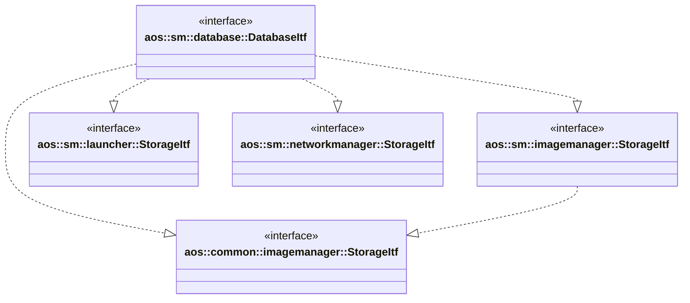

# Database

The database module provides persistent storage for various SM modules. It implements storage interfaces for the
following modules:

- [aos::common::imagemanager::StorageItf](../../common/imagemanager/itf/storage.hpp) - common image manager storage
  interface, inherited virtually so that the implementation may share it with a common image manager storage base
  class;
- [aos::sm::imagemanager::StorageItf](../imagemanager/itf/storage.hpp) - SM image manager storage interface, which
  extends the common one;
- [aos::sm::launcher::StorageItf](../launcher/itf/storage.hpp) - launcher storage interface.
- [aos::sm::networkmanager::StorageItf](../networkmanager/itf/storage.hpp) - network manager storage interface;

