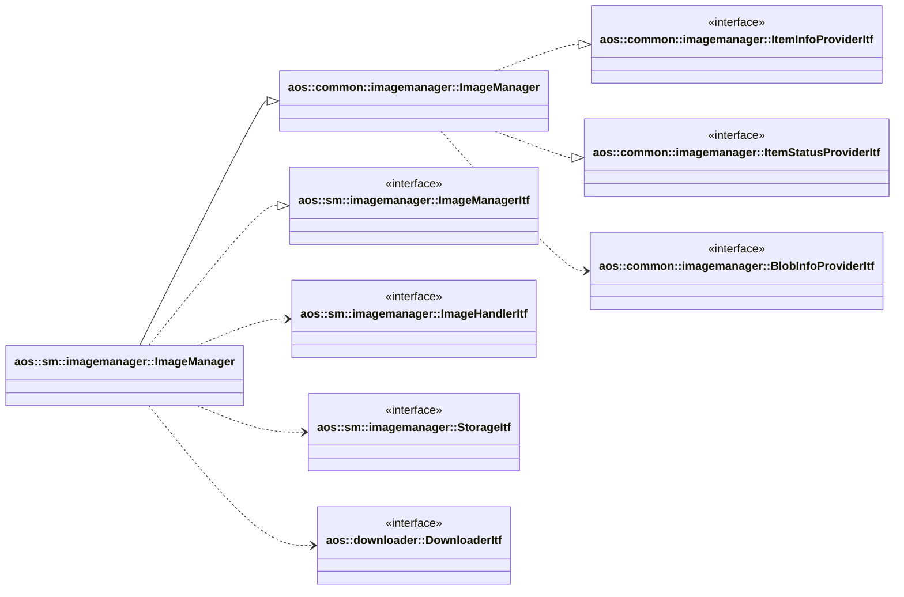

# Image manager

Image manager installs, removes and manages update items on SM side. It downloads the items from the CM and unpacks
their layers. A layer blob is removed once its layer is unpacked, only the unpacked layer is kept.

It is derived from the [common image manager](../../common/imagemanager/imagemanager.md), which installs and removes a
single version of an item, stores the items and their blobs, removes the outdated items and the orphan blobs, and
provides the item statuses. The SM image manager adds the following:

* converts `UpdateItemInfo` to the common `InstallItemInfo`. `mIsRootIndex` is `false`, as the SM manages a dedicated
  architecture only and processes the item blobs from the image manifest;
* downloads a blob from the URLs in the `BlobInfo` provided by `smclient`. The download error, for example `eIntegrity`
  of a broken blob on the CM, is returned as is. The downloaded blob is validated by the common image manager;
* unpacks, validates and removes the layers identified by the `diff_id`. A layer without a `diff_id`, i.e. of an item
  without an image config, is kept as a packed blob only. Only the `tar` and `tar+gzip` layer media types are
  supported;
* removes the layer blob and frees its space after the layer is unpacked, or when `UnpackLayer` finds the layer already
  valid. The blob reference stays in the storage, so a repair downloads the blob again if the unpacked layer is broken.
  A blob that can't be removed is logged and kept with its space accepted until the layer is processed again or the
  item is removed. On a failed unpack, the blob is kept;
* removes the orphan unpacked layers;
* provides the paths of the unpacked layers.

The unpacked layers are stored in `<mImagePath>/layers/<algorithm>/<hash>`:

* `layer` - unpacked layer content, returned by `GetLayerPath`;
* `digest` - digest of the unpacked content, used to validate the layer;
* `size` - unpacked size reported by the image handler.

`digest` and `size` are written last, so a layer without them is not completely unpacked.

Different layer blobs, for example compressed in different ways, can be unpacked to the same layer. So the processing of
the layers with the same `diff_id` is serialized in `ValidateLayer` and `UnpackLayer`, `UnpackLayer` skips a layer that
is already valid, and an unpacked layer is removed only if `IsLayerUsed` of the storage returns `false`. `RemoveLayer`
and the orphan layers cleanup never wait for a `diff_id`: they may be called from the item remover, so a layer being
processed is skipped.

It implements the following interfaces:

* [aos::sm::imagemanager::ImageManagerItf](itf/imagemanager.hpp) - installs, removes update items, cancels the install;
* [aos::common::imagemanager::ItemInfoProviderItf](../../common/imagemanager/itf/iteminfoprovider.hpp) - provides info
  about installed blobs, layers;
* [aos::common::imagemanager::ItemStatusProviderItf](../../common/imagemanager/itf/itemstatusprovider.hpp) - provides
  item statuses.

It requires the following interfaces:

* [aos::sm::imagemanager::ImageHandlerItf](itf/imagehandler.hpp) - performs platform dependant layers unpacking;
* [aos::sm::imagemanager::StorageItf](itf/storage.hpp) - extends the common storage with `IsLayerUsed`;
* [aos::common::imagemanager::BlobInfoProviderItf](../../common/imagemanager/itf/blobinfoprovider.hpp) - gets blob
  download info;
* [aos::downloader::DownloaderItf](../../common/downloader/itf/downloader.hpp) - downloads blobs.

