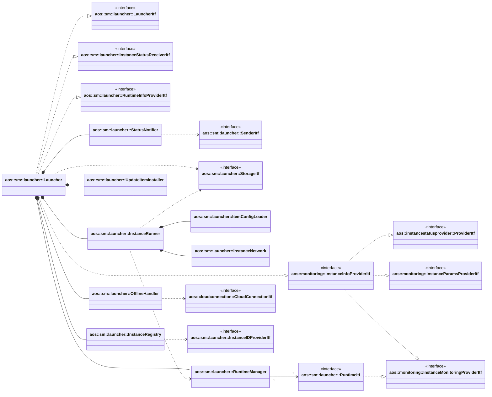
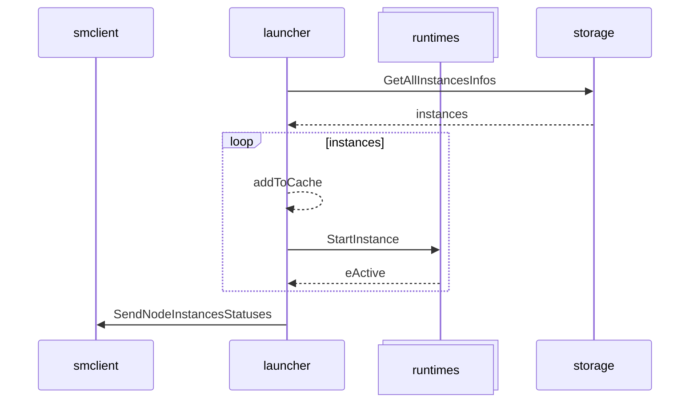
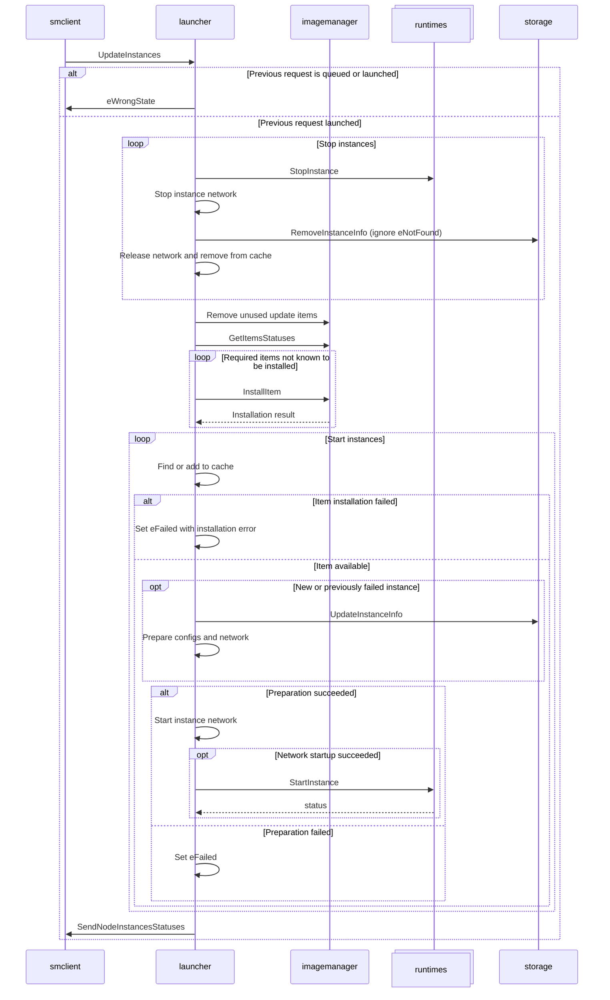

# Launcher

Launcher module aims to launch different types of Aos items, such as Aos services, components etc. This module
is responsible for launching items with respect to runtime dependencies on node start
and supervising items at runtime.

It uses different runtimes to run appropriate update item.

It implements the following interfaces:

* [aos::sm::launcher::LauncherItf](itf/launcher.hpp) - implements main launcher functionality to update Aos items;
* [aos::sm::launcher::InstanceStatusReceiverItf](itf/instancestatusreceiver.hpp) - to receive instances statuses
  from runtimes;
* [aos::sm::launcher::RuntimeInfoProviderItf](itf/runtimeinfoprovider.hpp) - to provide runtime info.
* [aos::monitoring::InstanceInfoProviderItf](../../common/monitoring/itf/instanceinfoprovider.hpp) - provides
  instance info: monitoring parameters, monitoring data, instance statuses. Also, it's capable of managing instance
  status events subscription and notifications and inherits the following interfaces:
  * [aos::instancestatusprovider::ProviderItf](../../common/instancestatusprovider/itf/instancestatusprovider.hpp) -
    providers instance statuses;
  * [aos::monitoring::InstanceParamsProviderItf](../../common/monitoring/itf/instanceparamsprovider.hpp) - provides
    instance monitoring parameters;
  * [aos::monitoring::InstanceMonitoringProviderItf](../../common/monitoring/itf/instancemonitoringprovider.hpp) -
    provides instance monitoring data.

It requires the following interfaces:

* [aos::sm::launcher::RuntimeItf](itf/runtime.hpp) - launch different kind of items on different runtimes, and
  provides instance monitoring data (implements `aos::monitoring::InstanceMonitoringProviderItf` interface);
* [aos::sm::launcher::StorageItf](itf/storage.hpp) - persistently store current instances;
* [aos::sm::launcher::SenderItf](itf/sender.hpp) - sends node and updated instances statuses;
* [aos::sm::imagemanager::ImageManagerItf](../imagemanager/itf/imagemanager.hpp) - installs and removes update items,
  cancels the items being installed when the launcher is stopped;
* [aos::common::imagemanager::ItemStatusProviderItf](../../common/imagemanager/itf/itemstatusprovider.hpp) - provides
  the states of the stored update items;
* [aos::common::imagemanager::ItemInfoProviderItf](../../common/imagemanager/itf/iteminfoprovider.hpp) - provides the
  local paths of the blobs;
* [aos::sm::launcher::InstanceIDProviderItf](itf/instanceidprovider.hpp) - provides the instance ID used to identify
  the instance network;
* [aos::sm::networkmanager::NetworkManagerItf](../networkmanager/itf/networkmanager.hpp) - creates, starts, stops and
  releases the instance networks;
* [aos::sm::resourcemanager::ResourceInfoProviderItf](../resourcemanager/itf/resourceinfoprovider.hpp) - provides the
  hosts of the resources used by the instances.

## Internal structure

The launcher orchestrates the classes below. It decides which instances to stop, install, start and repair; the
classes perform the steps.

The launcher keeps the data of the node instances in
[aos::sm::launcher::InstanceRegistry](instanceregistry.hpp). For each instance, the registry stores the instance
info, the instance status, the instance ID, the offline TTL, whether the item configs are loaded and whether the
instance is prepared. It adds an instance in the `eInactive` state, gets its instance ID from `InstanceIDProviderItf`,
finds an instance by ident or by instance ID, removes it, and returns the instances statuses and the minimal offline
TTL of the active and activating instances.

The registry isn't thread safe: the launcher serializes the access to it with its own lock. Only the launcher thread
adds and removes instances, so it passes the pointers to the instance data to the classes which process them.

[aos::sm::launcher::InstanceRunner](instancerunner.hpp) starts and stops the instances given by the launcher, in
parallel in its own thread pool:

* start: stores the not prepared instance and, for a service, loads its item configs and creates its network; then
  starts the networks of the services in a network batch, and starts the instances in their runtimes. The configs of a
  service which weren't loaded on module start are loaded first, and only a broken content fails the start, with
  `eIntegrity`. An already started instance isn't an error;
* stop: stops the instances in their runtimes, then stops the networks of the services in a network batch. A not found
  instance isn't an error;
* release: removes the instances from the storage and releases their networks.

Each step sets the instance state under the launcher lock: `eActivating` and `eActive` on start, `eInactive` on stop
and `eFailed` with the error of the failed step. A failed instance is skipped by the next steps.

The instance runner loads the item config and the image config of a service instance with
[aos::sm::launcher::ItemConfigLoader](itemconfigloader.hpp). The loader gets the image manifest blob by the manifest
digest of the instance, then the item config and image config blobs referenced by the manifest. It gets the blob paths
from `ItemInfoProviderItf` and parses the blobs with `OCISpecItf`. A manifest without an item config fails with
`eNotFound`, and a broken blob fails with the error of `OCISpecItf`, for example `eIntegrity`.

The instance runner manages the instance networks with
[aos::sm::launcher::InstanceNetwork](instancenetwork.hpp), which calls `NetworkManagerItf` with the instance ID and the
owner ID of the instance. It creates the instance network configured by the item and image configs: the hostname, the
traffic quotas, the allowed connections, the exposed ports of the image and the hosts of the resources used by the
instance, which it gets from `ResourceInfoProviderItf`. It also starts, stops and releases the instance network, and
begins and flushes the network batch. An existing network on create or start and a not found network on stop aren't
errors.

[aos::sm::launcher::UpdateItemInstaller](updateiteminstaller.hpp) installs, repairs and removes the update items, in
parallel in its own thread pool. It finds the item versions used by the stopped instances and not used by the started
ones and removes them. It installs the items of the started instances which `ItemStatusProviderItf` doesn't report as
installed, once per item ID and version. It repairs the broken items by installing them again, and remembers the
repaired item versions: see [Integrity recovery](#integrity-recovery). It counts the installs in progress under its
own lock: on launcher stop, it rejects the new installs with `eCanceled` and cancels `ImageManagerItf` until all
installs in progress return.

The launcher keeps the node runtimes in [aos::sm::launcher::RuntimeManager](runtimemanager.hpp). On start, the runtime
manager starts the runtimes, reads their runtime IDs and passes to each runtime the stored instances which run on it.
It finds the runtime of an instance by its runtime ID and reboots the runtimes. On stop, it stops all runtimes, even
if some of them fail to stop.

[aos::sm::launcher::OfflineHandler](offlinehandler.hpp) tracks the time the node is offline: see
[Offline TTL](#offline-ttl).

[aos::sm::launcher::StatusNotifier](statusnotifier.hpp) sends the node instances statuses and the changed instances
statuses to the CM with `SenderItf`, and notifies the instance status listeners.

## Launcher jobs

The launcher runs one job at a time on its thread:

* update: the request received with `UpdateInstances`, and the start of the stored instances on module start;
* repair: the repair of the instances which their runtime reported failed with `eIntegrity`;
* offline check: the stop of the instances whose offline TTL expired;
* reboot: the reboot of the runtimes which require it.

The jobs never overlap, so a reboot or an offline TTL never interrupts a launch. The pending update runs first, then
the repair, the offline check and the reboot. When the launcher stops, the job in progress is finished and the pending
jobs are dropped. After each job, the launcher arms the offline handler again.

## Initialization

On SM start, launcher gets items that should be started on this node from the storage, checks current item status and
starts or stops corresponding item depends on its status. After all items updated, it sends node instances status using
`InstanceStatusSenderItf`.

Launcher processes instances in parallel using a thread pool.

## Update instances

On update instances request, launcher checks if a previous request is queued or still launched. If so, it returns
`eWrongState` error. Otherwise, it queues the request and returns: a request received during the repair which ends a
previous request is processed after it. The update job stops the requested instances and removes them from storage
and local cache.
It then removes unused update items and installs required items, once per item ID and version.
If reading the item statuses fails, launcher logs the error and attempts to install all required items.

An installation failure marks every dependent instance as `eFailed` with the installation error. These instances
remain in the local cache for status reporting, but are not prepared, persisted, or started. Other items can still
start normally. On a subsequent request, cached `eFailed` instances are prepared again after successful installation.
This retry applies to all failed instances, including failures during preparation or runtime startup. A failed
instance is reset to `eInactive` before it's prepared again, so the error of the new attempt is reported. A running
instance which is requested again keeps its state while the request is processed: it isn't reset to `eInactive`.

After preparing eligible instances, launcher starts their networks and runtimes and sends node instances statuses.

The update item installer and the instance runner process the items and the instances in parallel using their thread
pools. Installation, preparation, network startup, and runtime startup are separate stages; each stage completes before
the next one starts.

The network stop and start stages run within a network manager batch: the batch is flushed once all instances of
the stage are processed. An instance whose network fails to start in the batch is set `eFailed` and its network is
stopped. A network which fails to stop in the batch is only logged. If the batch can't be started, the networks are
still processed, and no failures are collected from the batch.

## Integrity recovery

Launcher repairs the update items whose content is broken by installing them again with
`ImageManagerItf::InstallItem`, which validates the item and downloads only the broken blobs. Launcher watches the
instances statuses: an instance fails with `eIntegrity` when its item configs fail to read on prepare or start, when
its runtime fails to start it, or when its runtime reports it failed with `eIntegrity` while it runs.

The repair runs:

* in place, at the end of each update job, before the node instances statuses are sent. It repairs the instances
  failed by the job and the ones reported failed by their runtime meanwhile;
* as a repair job, when a runtime reports an instance failed with `eIntegrity` outside an update job.

The repair asks the update item installer to install again once each item of the failed instances, then the instance
runner prepares and starts again the failed instances of the repaired items. The instances of an item which can't be
repaired stay failed with the repair error, and an instance which fails again stays failed with the error of this
attempt.

An item version is repaired once until the next request for it: its instances which fail again, including the ones
reported by the runtime later, stay failed. The new or failed instances of an item whose installation failed in a
request aren't started and aren't repaired either: they stay failed with the installation error until the next request.
A running instance of such an item keeps running.

The repair may wait for the CM, which may be not connected yet on module start and gets the instances statuses when
it connects. So the instances statuses request doesn't wait for the repair, a request received during the repair is
processed after it, and the node instances statuses are sent after the repair. On module start, they are sent only if
the repair changes them. A failure reported while the launcher stops doesn't start a repair.

## Offline TTL

The offline handler subscribes to `CloudConnectionItf` and keeps the time the cloud disconnected. The disconnect
requests an offline check job, which stops the active and activating instances whose offline TTL expired. After each
job, the launcher arms the offline handler with the minimal offline TTL of the running instances: when it expires, the
handler requests the next offline check. The cloud connect resets the offline time and cancels the armed check.

## aos::sm::launcher::InstanceStatusReceiverItf

### OnInstancesStatusesReceived

Receive instances statuses.

### RebootRequired

Marks runtime for reboot. Reboot will be performed after current launch is completed.

## aos::sm::launcher::InstanceStatusSenderItf

### SendNodeInstancesStatuses

Sends node instances statuses once update is completed.

### SendUpdateInstancesStatuses

Propagates updated instances statuses received from runtimes.

## aos::sm::launcher::LauncherItf

Implements main launcher functionality to start and stop node instances.

### UpdateInstances

Start and stop node instances.

## aos::sm::launcher::RebooterItf

### Reboot

Reboots the system.

## aos::sm::launcher::UpdateCheckerItf

### Check

Checks if update succeeded.
