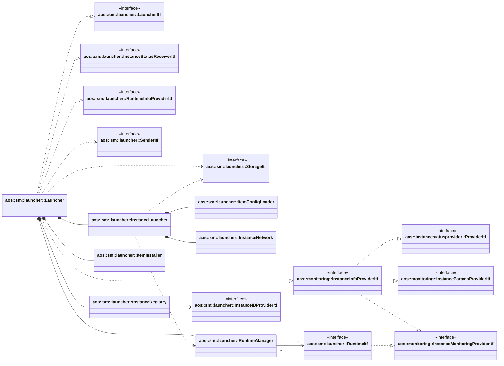
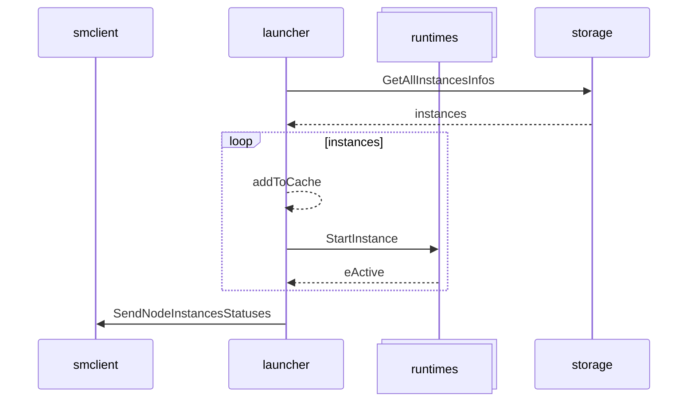

# Launcher

Launcher module aims to launch different types of Aos items, such as Aos services, components etc. This module
is responsible for launching items with respect to runtime dependencies on node start
and supervising items at runtime.

It uses different runtimes to run appropriate update item.

It implements the following interfaces:

* [aos::sm::launcher::LauncherItf](itf/launcher.hpp) - implements main launcher functionality to update Aos items;
* [aos::sm::launcher::InstanceStatusReceiverItf](itf/instancestatusreceiver.hpp) - to receive instances statuses
  from runtimes;
* [aos::sm::launcher::RuntimeInfoProviderItf](itf/runtimeinfoprovider.hpp) - to provide runtime info.
* [aos::monitoring::InstanceInfoProviderItf](../../common/monitoring/itf/instanceinfoprovider.hpp) - provides
  instance info: monitoring parameters, monitoring data, instance statuses. Also, it's capable of managing instance
  status events subscription and notifications and inherits the following interfaces:
  * [aos::instancestatusprovider::ProviderItf](../../common/instancestatusprovider/itf/instancestatusprovider.hpp) -
    providers instance statuses;
  * [aos::monitoring::InstanceParamsProviderItf](../../common/monitoring/itf/instanceparamsprovider.hpp) - provides
    instance monitoring parameters;
  * [aos::monitoring::InstanceMonitoringProviderItf](../../common/monitoring/itf/instancemonitoringprovider.hpp) -
    provides instance monitoring data.

It requires the following interfaces:

* [aos::sm::launcher::RuntimeItf](itf/runtime.hpp) - launch different kind of items on different runtimes, and
  provides instance monitoring data (implements `aos::monitoring::InstanceMonitoringProviderItf` interface);
* [aos::sm::launcher::StorageItf](itf/storage.hpp) - persistently store current instances;
* [aos::sm::launcher::SenderItf](itf/sender.hpp) - sends node and updated instances statuses;
* [aos::sm::imagemanager::ImageManagerItf](../imagemanager/itf/imagemanager.hpp) - installs and removes update items,
  cancels the items being installed when the launcher is stopped;
* [aos::common::imagemanager::ItemStatusProviderItf](../../common/imagemanager/itf/itemstatusprovider.hpp) - provides
  the states of the stored update items;
* [aos::common::imagemanager::ItemInfoProviderItf](../../common/imagemanager/itf/iteminfoprovider.hpp) - provides the
  local paths of the blobs;
* [aos::sm::launcher::InstanceIDProviderItf](itf/instanceidprovider.hpp) - provides the instance ID used to identify
  the instance network;
* [aos::sm::networkmanager::NetworkManagerItf](../networkmanager/itf/networkmanager.hpp) - creates, starts, stops and
  releases the instance networks;
* [aos::sm::resourcemanager::ResourceInfoProviderItf](../resourcemanager/itf/resourceinfoprovider.hpp) - provides the
  hosts of the resources used by the instances.

## Internal structure

The launcher keeps the data of the node instances in
[aos::sm::launcher::InstanceRegistry](instanceregistry.hpp). For each instance, the registry stores the instance
info, the instance status, the instance ID, the offline TTL and whether the item configs are loaded. It adds an
instance in the `eInactive` state, gets its instance ID from `InstanceIDProviderItf`, finds an instance by ident or
by instance ID, removes it, and returns the instances statuses and the minimal offline TTL of the active and
activating instances.

The registry isn't thread safe: the launcher serializes the access to it with its own lock. The pointers to the
instance data stay valid until the instance is removed, so the launch stages pass them to the thread pool tasks.

The launcher performs the steps which start and stop an instance with
[aos::sm::launcher::InstanceLauncher](instancelauncher.hpp):

* prepare: stores the instance and, for a service, loads its item configs and creates its network;
* start network and stop network;
* start: starts the instance in its runtime. The configs of a service which weren't loaded on module start are loaded
  first, and only a broken content fails the start, with `eIntegrity`. An already started instance isn't an error;
* stop: stops the instance in its runtime. A not found instance isn't an error;
* release: removes the instance from the storage and releases its network.

The instance launcher finds the runtime of the instance in `RuntimeManager` and doesn't change the instance state: it
returns the error of the step, and the launcher decides about the instance, including the integrity recovery. The
launcher runs the steps of all instances of a stage in its thread pool, and the network starts and stops within a
network batch, which it begins and flushes through the instance launcher.

The instance launcher loads the item config and the image config of a service instance with
[aos::sm::launcher::ItemConfigLoader](itemconfigloader.hpp). The loader gets the image manifest blob by the manifest
digest of the instance, then the item config and image config blobs referenced by the manifest. It gets the blob paths
from `ItemInfoProviderItf` and parses the blobs with `OCISpecItf`. A manifest without an item config fails with
`eNotFound`, and a broken blob fails with the error of `OCISpecItf`, for example `eIntegrity`.

The instance launcher manages the instance networks with
[aos::sm::launcher::InstanceNetwork](instancenetwork.hpp), which calls `NetworkManagerItf` with the instance ID and the
owner ID of the instance. It creates the instance network configured by the item and image configs: the hostname, the
traffic quotas, the allowed connections, the exposed ports of the image and the hosts of the resources used by the
instance, which it gets from `ResourceInfoProviderItf`. It also starts, stops and releases the instance network, and
begins and flushes the network batch. An existing network on create or start and a not found network on stop aren't
errors.

The launcher installs and removes the update items with [aos::sm::launcher::ItemInstaller](iteminstaller.hpp). The
installer finds the item versions used by the stopped instances and not used by the started ones, removes them, and
installs the items of the started instances which `ItemStatusProviderItf` doesn't report as installed, once per item
ID and version. It also installs a single item for the integrity recovery. The installer runs the installs and
removals in the launcher thread pool. It counts the installs in progress under its own lock: on launcher stop, it
rejects the new installs with `eCanceled` and cancels `ImageManagerItf` until all installs in progress return.

The launcher keeps the node runtimes in [aos::sm::launcher::RuntimeManager](runtimemanager.hpp). On start, the runtime
manager starts the runtimes, reads their runtime IDs and passes to each runtime the stored instances which run on it.
The launcher finds the runtime of an instance by its runtime ID. On stop, the runtime manager stops all runtimes, even
if some of them fail to stop. Like the instance registry, it isn't thread safe and the launcher serializes the access
to it. The launcher queues the runtimes which require reboot and reboots them when no launch is in progress.

## Initialization

On SM start, launcher gets items that should be started on this node from the storage, checks current item status and
starts or stops corresponding item depends on its status. After all items updated, it sends node instances status using
`InstanceStatusSenderItf`.

Launcher processes instances in parallel using a thread pool.

## Update instances

On update instances request, launcher checks if previous launch is still in progress. If so, it returns
`eWrongState` error. Otherwise, it stops the requested instances and removes them from storage and local cache.
It then removes unused update items and installs required items, once per item ID and version.
If reading the item statuses fails, launcher logs the error and attempts to install all required items.

An installation failure marks every dependent instance as `eFailed` with the installation error. These instances
remain in the local cache for status reporting, but are not prepared, persisted, or started. Other items can still
start normally. On a subsequent request, cached `eFailed` instances are prepared again after successful installation.
This retry applies to all failed instances, including failures during preparation or runtime startup. A failed
instance is reset to `eInactive` before it's prepared again, so the error of the new attempt is reported. A running
instance which is requested again keeps its state while the request is processed: it isn't reset to `eInactive`.

After preparing eligible instances, launcher starts their networks and runtimes and sends node instances statuses.

Launcher processes instances in parallel using a thread pool. Installation, preparation, network startup, and
runtime startup are separate stages; each stage completes before the next one starts.

The network stop and start stages run within a network manager batch: the batch is flushed once all instances of
the stage are processed. An instance whose network fails to start in the batch is set `eFailed` and its network is
stopped. A network which fails to stop in the batch is only logged. If the batch can't be started, the networks are
still processed, and no failures are collected from the batch.

## Integrity recovery

Launcher repairs the update items whose content is broken by installing them again with
`ImageManagerItf::InstallItem`, which validates the item and downloads only the broken blobs. An item is repaired at
most once per request:

* after the instances of a request are prepared, launcher installs again once each item that has an instance whose
  item configs failed to read with `eIntegrity`. Then it prepares again the failed instances of the repaired items;
* after the instances of a request are started, launcher installs again once each item that has an instance failed to
  start with `eIntegrity`, unless the item was already repaired at the prepare stage. Then it starts again the failed
  instances of the repaired items.

The instances of an item which can't be repaired stay failed with the repair error, and an instance which fails the
second prepare or start stays failed with the error of this attempt.

The repair needs the CM, which may be not connected on module start, so the stored instances are read and started
without the repair. The first request handles the broken content: it prepares and starts again the instances failed
with `eIntegrity`, and prepares again the running instances whose item configs failed to read on module start.

Any other error doesn't trigger the repair. The new or failed instances of an item whose installation failed aren't
started, so they aren't repaired either: they stay failed with the installation error until the next request. A
running instance of such an item keeps running.

## aos::sm::launcher::InstanceStatusReceiverItf

### OnInstancesStatusesReceived

Receive instances statuses.

### RebootRequired

Marks runtime for reboot. Reboot will be performed after current launch is completed.

## aos::sm::launcher::InstanceStatusSenderItf

### SendNodeInstancesStatuses

Sends node instances statuses once update is completed.

### SendUpdateInstancesStatuses

Propagates updated instances statuses received from runtimes.

## aos::sm::launcher::LauncherItf

Implements main launcher functionality to start and stop node instances.

### UpdateInstances

Start and stop node instances.

## aos::sm::launcher::RebooterItf

### Reboot

Reboots the system.

## aos::sm::launcher::UpdateCheckerItf

### Check

Checks if update succeeded.
