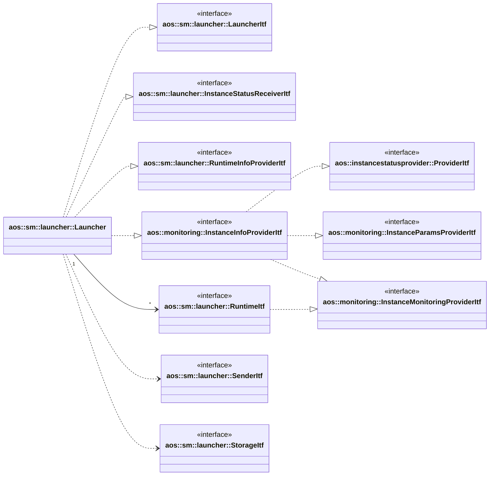
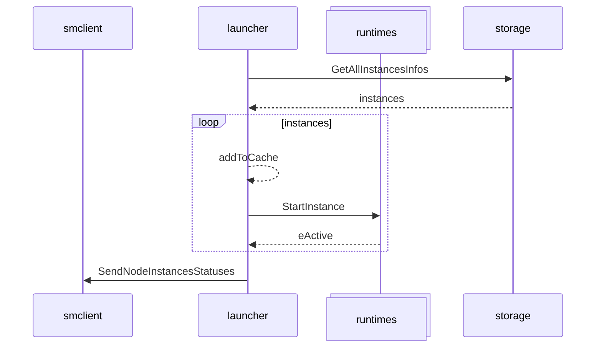
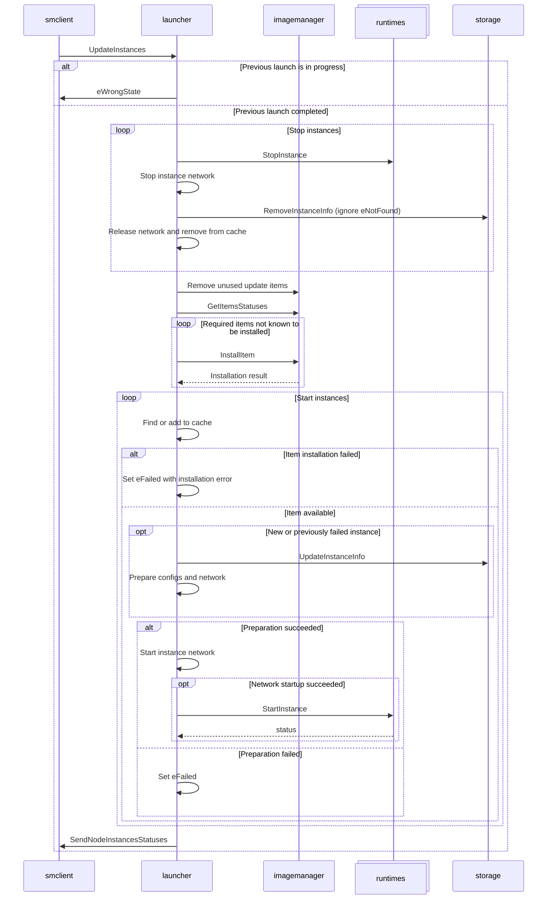

# Launcher

Launcher module aims to launch different types of Aos items, such as Aos services, components etc. This module
is responsible for launching items with respect to runtime dependencies on node start
and supervising items at runtime.

It uses different runtimes to run appropriate update item.

It implements the following interfaces:

* [aos::sm::launcher::LauncherItf](itf/launcher.hpp) - implements main launcher functionality to update Aos items;
* [aos::sm::launcher::InstanceStatusReceiverItf](itf/instancestatusreceiver.hpp) - to receive instances statuses
  from runtimes;
* [aos::sm::launcher::RuntimeInfoProviderItf](itf/runtimeinfoprovider.hpp) - to provide runtime info.
* [aos::monitoring::InstanceInfoProviderItf](../../common/monitoring/itf/instanceinfoprovider.hpp) - provides
  instance info: monitoring parameters, monitoring data, instance statuses. Also, it's capable of managing instance
  status events subscription and notifications and inherits the following interfaces:
  * [aos::instancestatusprovider::ProviderItf](../../common/instancestatusprovider/itf/instancestatusprovider.hpp) -
    providers instance statuses;
  * [aos::monitoring::InstanceParamsProviderItf](../../common/monitoring/itf/instanceparamsprovider.hpp) - provides
    instance monitoring parameters;
  * [aos::monitoring::InstanceMonitoringProviderItf](../../common/monitoring/itf/instancemonitoringprovider.hpp) -
    provides instance monitoring data.

It requires the following interfaces:

* [aos::sm::launcher::RuntimeItf](itf/runtime.hpp) - launch different kind of items on different runtimes, and
  provides instance monitoring data (implements `aos::monitoring::InstanceMonitoringProviderItf` interface);
* [aos::sm::launcher::StorageItf](itf/storage.hpp) - persistently store current instances;
* [aos::sm::launcher::SenderItf](itf/sender.hpp) - sends node and updated instances statuses;
* [aos::sm::imagemanager::ImageManagerItf](../imagemanager/itf/imagemanager.hpp) - installs and removes update items,
  cancels the items being installed when the launcher is stopped;
* [aos::common::imagemanager::ItemStatusProviderItf](../../common/imagemanager/itf/itemstatusprovider.hpp) - provides
  the states of the stored update items;
* [aos::common::imagemanager::ItemInfoProviderItf](../../common/imagemanager/itf/iteminfoprovider.hpp) - provides the
  local paths of the blobs.

## Initialization

On SM start, launcher gets items that should be started on this node from the storage, checks current item status and
starts or stops corresponding item depends on its status. After all items updated, it sends node instances status using
`InstanceStatusSenderItf`.

Launcher processes instances in parallel using a thread pool.

## Update instances

On update instances request, launcher checks if previous launch is still in progress. If so, it returns
`eWrongState` error. Otherwise, it stops the requested instances and removes them from storage and local cache.
It then removes unused update items and installs required items, once per item ID and version.
If reading the item statuses fails, launcher logs the error and attempts to install all required items.

An installation failure marks every dependent instance as `eFailed` with the installation error. These instances
remain in the local cache for status reporting, but are not prepared, persisted, or started. Other items can still
start normally. On a subsequent request, cached `eFailed` instances are prepared again after successful installation.
This retry applies to all failed instances, including failures during preparation or runtime startup.

After preparing eligible instances, launcher starts their networks and runtimes and sends node instances statuses.

Launcher processes instances in parallel using a thread pool. Installation, preparation, network startup, and
runtime startup are separate stages; each stage completes before the next one starts.

## Integrity recovery

Launcher repairs the update items whose content is broken by installing them again with
`ImageManagerItf::InstallItem`, which validates the item and downloads only the broken blobs. An item is repaired at
most once per request:

* after the instances of a request are prepared, launcher installs again once each item that has an instance whose
  item configs failed to read with `eIntegrity`. Then it prepares again the failed instances of the repaired items;
* after the instances of a request are started, launcher installs again once each item that has an instance failed to
  start with `eIntegrity`, unless the item was already repaired at the prepare stage. Then it starts again the failed
  instances of the repaired items.

The instances of an item which can't be repaired stay failed with the repair error, and an instance which fails the
second prepare or start stays failed with the error of this attempt.

The repair needs the CM, which may be not connected on module start, so the stored instances are read and started
without the repair. The first request handles the broken content: it prepares and starts again the instances failed
with `eIntegrity`, and prepares again the running instances whose item configs failed to read on module start.

Any other error doesn't trigger the repair. The new or failed instances of an item whose installation failed aren't
started, so they aren't repaired either: they stay failed with the installation error until the next request. A
running instance of such an item keeps running.

## aos::sm::launcher::InstanceStatusReceiverItf

### OnInstancesStatusesReceived

Receive instances statuses.

### RebootRequired

Marks runtime for reboot. Reboot will be performed after current launch is completed.

## aos::sm::launcher::InstanceStatusSenderItf

### SendNodeInstancesStatuses

Sends node instances statuses once update is completed.

### SendUpdateInstancesStatuses

Propagates updated instances statuses received from runtimes.

## aos::sm::launcher::LauncherItf

Implements main launcher functionality to start and stop node instances.

### UpdateInstances

Start and stop node instances.

## aos::sm::launcher::RebooterItf

### Reboot

Reboots the system.

## aos::sm::launcher::UpdateCheckerItf

### Check

Checks if update succeeded.
